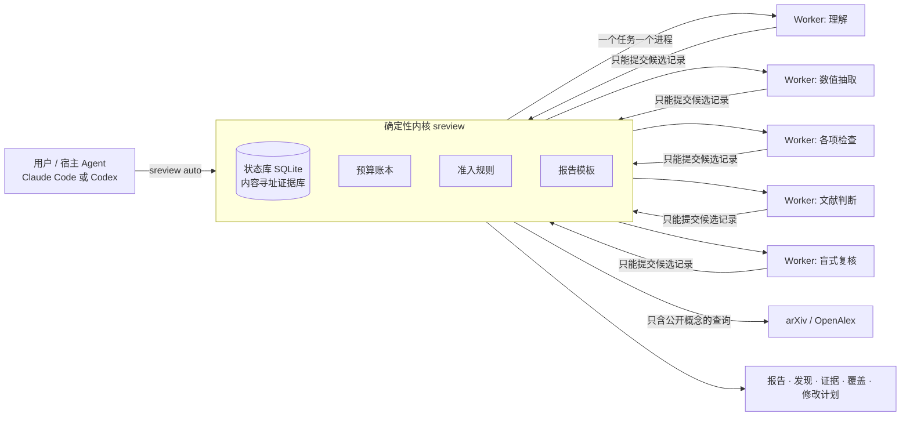

# ScholarlyReview

**ScholarlyReview 是一个让大模型审论文、又不让它“信口开河”的工具。** 它面向 AI / 机器学习论文，有两种用法：作者在投稿前用它给自己的稿件做一次严格的自查；审稿人用它辅助审一篇投稿，起草审稿意见、评分和推荐结论。

它和“把 PDF 丢给 ChatGPT 让它写审稿意见”的区别在于：**模型只能提出候选意见，是否写进报告由一个确定性的程序内核决定。** 每一条进入报告的意见，都必须能追溯到原文里的某一句话、一次程序复算，或一次独立复核。找不到依据的意见，内核会拒收。

> 状态：v0.1，可用的研究原型。87 个自动化测试全部通过，已在公开论文和真实投稿上试运行。审稿质量还没有做大规模评测（见[现状与局限](#现状与局限)），**它的输出是草稿和线索，不能替代人的判断。**

---

## 目录

- [为什么要做这个工具](#为什么要做这个工具)
- [它是怎么做的](#它是怎么做的)
- [功能一览](#功能一览)
- [实测效果与成本](#实测效果与成本)
- [快速开始](#快速开始)
- [使用说明](#使用说明)
- [一次运行的完整流程](#一次运行的完整流程)
- [项目结构](#项目结构)
- [现状与局限](#现状与局限)
- [隐私、保密与使用伦理](#隐私保密与使用伦理)
- [开发与测试](#开发与测试)

---

## 为什么要做这个工具

用大模型审论文已经很普遍，但直接让模型读稿件、写意见，有几个反复出现的问题：

| 问题 | 具体表现 |
| --- | --- |
| **编造依据** | 意见里引用的数字、句子、表格在原文中并不存在，或者被改写过。 |
| **算错数** | 模型“心算”百分比、提升幅度、F1 时经常出错，于是把正确的论文判成矛盾，或者放过真正的矛盾。 |
| **自己给自己背书** | 同一个上下文里，模型提出问题之后再“复核”，几乎总是同意自己。 |
| **严重度和结论不稳定** | 同一类问题，在这篇里是 major，在那篇里是 minor；问题更多的稿件反而拿到更宽松的推荐。 |
| **说不清做了什么** | 报告不交代哪些检查做了、哪些没做、预算是否用完，读者无法判断“没提到”是“没问题”还是“没查”。 |
| **泄露稿件** | 为了查文献，把未发表稿件的标题、摘要原句发到外部搜索服务。 |
| **成本失控** | 长稿件、多轮调用，一次审稿的 token 消耗很难预估和控制。 |

ScholarlyReview 的做法是把“判断”和“记账”拆开：**模型负责阅读和提出看法，程序负责核对证据、做算术、控制复核方式、记录覆盖范围和预算，并决定什么能进报告。**

## 它是怎么做的

### 核心设计：内核 + 短命 Worker



- **内核**（Python 包 `scholarly_review`，命令行 `sreview`）持有全部状态：稿件快照、任务图、证据、预算、复核记录。它不调用模型做判断，所有规则都是确定性的。
- **Worker** 是内核临时启动的模型进程（`claude -p` 或 `codex exec`），每个只接一个任务，没有工具、没有 MCP、没有会话历史，做完即销毁。它只能按 JSON Schema 提交候选结果。
- **宿主**（你在 Claude Code / Codex 里的会话）只发一条命令，读回一份紧凑的 JSON 摘要，不需要自己读整篇稿件。

### 六条证据纪律

1. **原文锚定。** 每条主张、每个问题都必须引用原文。内核在稿件里逐字（或容错地）定位引文，定位不到就拒收。
2. **数字由程序算。** 模型只负责抄录数字和指明运算关系（差值、比值、混淆矩阵指标、舍入区间等），内核做确定性复算。输入数字必须在引用原文中逐字出现，否则只能列为“待澄清”。
3. **盲式复核。** 复核任务看不到候选结论，只拿到一个中性问题，并被要求先找反证。复核在新的 Worker 进程里进行，内核检查它的事件流，确认确实隔离（无工具、未读越界文件）后才记为 `fresh`；否则记为 `inherited`，不能确认 major 问题。
4. **统一的严重度和结论规则。** 每类问题（泄漏、基线不公平、只跑一次、核心数据集不可获得……）对应固定的影响级别，只看问题本身，不看期刊、论文整体印象或作者是谁。推荐结论按选项的含义（reject / major / minor / accept）受内核约束：存在已确认的、需要新实验的 major 问题时，不能给 minor 或 accept。
5. **覆盖如实报告。** 每个任务申报看了什么、没看什么。只有真正的缺口（核心主张没评估、文献一次都没检索成功、复核没覆盖全部问题）才会让报告标为“部分完成”；图里的数字读不到这类情况只作为范围说明。
6. **外发受控。** 文献检索只发给允许的服务（arXiv、OpenAlex），查询词只能是公开概念；内核拦截稿件标题和长句原文。

### 为什么报告不让模型润色

最终报告完全由确定性模板生成。写作阶段如果再交给模型，它可能把“待澄清”升级成“错误”，或者加入没经过准入的说法。用模板可以保证：报告里说的，就是准入记录里有的。

## 功能一览

### 两种模式

| | 作者自查（`/paper-preflight`，`--mode author`） | 审稿辅助（`/paper-referee`，`--mode reviewer`） |
| --- | --- | --- |
| 适用场景 | 投稿前检查自己的稿件 | 审一篇别人的投稿 |
| 主要输出 | 问题清单、优点、投稿准备度、按优先级排列的修改计划 | 审稿人私有笔记、给作者的意见、给编辑的意见（可选） |
| 评分与推荐 | 无 | 按期刊/会议表单起草评分和推荐结论（需提供表单），或使用通用的四档结论 |
| 投稿准备度 | `blocked` / `not_assessed` / `conditional` / `no_blocker_found` | — |

### 检查内容

所有检查都输出“问题 + 原文证据 + 建议动作”，并按严重度分级（critical / major / minor）。

- **通用检查（所有领域）：** 主张与证据是否对应、技术正确性、实验有效性、创新性与最接近工作的定位、内部一致性、可复现性、引用、表达。
- **数值复算：** 百分比、百分点与相对变化、均值与求和、比值与倍数（“快 14 倍”）、混淆矩阵指标（含两种 macro-F1 定义）、科学计数法、舍入区间传播。
- **文献定位：** Worker 提出只含公开概念的检索词，内核去 arXiv / OpenAlex 检索，再由另一个 Worker 判断最接近的已有工作是否被遗漏或被误述。会尊重截稿日期（`--cutoff`）。
- **领域专项检查**（standard 及以上档位）：

| 领域配置 | 适用 | 追加检查 |
| --- | --- | --- |
| `ml-v1`（默认） | 机器学习 / AI | 评测协议、基线公平性、消融与收益归因、统计证据、数据泄漏与预训练污染、主张范围与泛化、可复现与算力、局限与许可。并按识别出的子领域自动追加：LLM/NLP 评测有效性（prompt 对等、LLM-as-judge、模型版本）、智能体评测、视觉/多模态、强化学习、学习理论、图学习 |
| `systems-v1` | 网络与分布式系统 | 模型与可执行决策一致、资源守恒与可行性、负载与测试平台真实性、基线配置、开销与尾延迟 |
| `security-v1` | 安全 | 威胁模型、攻击者能力一致性、攻击覆盖与防御目标、自适应攻击、伦理与漏洞披露 |
| `generic-v1` | 其他学科 | 只做通用检查，报告注明缺少专用标准 |

### 输出

每次导出生成一个目录，包含：

| 文件 | 内容 |
| --- | --- |
| `report.md` / `report.txt` / `report.html` | 人读的报告：报告头（做了什么、没做什么、预算、主要限制）、优点、问题、待澄清事项、修改计划；审稿模式下另有评分和推荐草稿 |
| `findings.json` | 每条发现的结构化记录：结论、严重度、关联主张、证据 id、建议动作、准入结果 |
| `evidence.jsonl` | 证据记录：原文引文与定位、复算输入和结果、复核记录 |
| `coverage.json` | 覆盖统计：哪些检查完成、哪些主张被评估、范围说明 |

导出按受众过滤（`--audience`）：`author_private`、`reviewer_private`、`authors`、`editor`、`public`。例如评分、推荐和给编辑的保密意见不会出现在给作者的视图里。报告语言支持中文和英文（`--language zh-CN|en`）。

## 实测效果与成本

以下数据来自 [docs/IMPLEMENTATION_STATUS.md](docs/IMPLEMENTATION_STATUS.md) 中的试运行记录。样本量很小，只用于说明工具当前能做到什么，不代表统计意义上的准确率。

**植入缺陷评测（2026-11-24）。** 在两篇公开 arXiv 论文（ResNet、BatchNorm）的文本里植入 7 个缺陷（5 个数值缺陷、2 个结论与证据不符），答案对 Worker 保密。quick 档，Sonnet Worker：

| 论文 | 检出 | 报告条目 | 有用条目 | Worker 费用 | 用时 |
| --- | --- | --- | --- | --- | --- |
| ResNet | 4/4 | 8 | 7 | $1.10 | 177 s |
| BatchNorm | 2/3 | 8 | 5 | $0.91 | 194 s |

漏检的一项是一个写错的倍数。评测后修复了科学计数法解析，并让数值抽取覆盖所有“N 倍”类表述。两篇都是名篇，模型可能记得原文，检出率可能偏乐观。

**真实论文。** 在 Transformer 原论文上，程序复算找出了原文中两处真实存在的不一致（同一 BLEU 值在摘要和正文中不同；一处“优于所有此前模型”与表格数据不符）。

**严重度校准（2026-11-25）。** 对三篇真实投稿的审稿结论做公平性检查时发现：门槛更高的期刊反而得到更宽松的结论，同类问题在不同稿件里分级不同。加入统一严重度表和内核约束后重判，三篇结论一致地落在“需要大修”一档。

**成本。** 一条命令运行时，主会话几乎不读稿件，token 主要花在 Worker 上：

| 档位 | 典型费用（Sonnet Worker） | 说明 |
| --- | --- | --- |
| quick | 约 $1 / 篇 | 理解、数值复算、主张-证据、最接近工作 4 项任务，约 10 分钟 |
| standard | 约 $4.7 / 篇（实测一篇） | 加全部领域检查和子领域检查；稿件放进可缓存的系统提示、复核按 6 条一批合并后，较早期的 $7–8 下降约 40% |

## 快速开始

### 1. 安装

需要 Python 3.11 及以上，以及 [Claude Code](https://claude.com/claude-code) 或 Codex CLI 之一（Worker 由它们启动，使用你自己的登录或额度）。

```bash
git clone https://github.com/guxungang/ReviewToolCreate.git && cd ReviewToolCreate
```

```bash
python3.12 -m venv .venv && .venv/bin/pip install -e ".[dev]"
```

检查宿主能力（只读，不改动任何东西）：

```bash
.venv/bin/sreview doctor --host claude
```

### 2. 在 Claude Code / Codex 里用（推荐）

把两个 Skill 安装到当前项目：

```bash
.venv/bin/sreview install --host claude --scope project
```

然后在 Claude Code 中直接说：

```text
/paper-preflight papers/draft.pdf，standard，中文输出
/paper-referee papers/submission.pdf，standard，使用 reviews/form.json，给出评分和推荐
```

Skill 会先收集稿件、附录、目标期刊、截稿日期、审稿表单、能否补实验和输出语言，没指定档位时让你选择，然后调用 `sreview auto` 跑完全程，最后用中文/英文向你解释报告。Codex 用 `--host codex` 安装，入口为 `$paper-preflight` 和 `$paper-referee`。

### 3. 直接用命令行

作者自查，quick 档，用 Sonnet 做 Worker：

```bash
.venv/bin/sreview auto --manuscript paper.pdf --mode author --effort quick --host claude --worker-model sonnet --language zh-CN
```

审稿，standard 档，按会议表单起草评分和推荐：

```bash
.venv/bin/sreview auto --manuscript submission.pdf --mode reviewer --effort standard --host claude --worker-model sonnet --rubric form.json --scores --recommendation
```

`auto` 每次最多工作 7 分钟（`--slice`），没做完会返回 `next`，用 `--run <run_id>` 接着跑。跑完后报告在 `.scholarly-review/exports/<run_id>/<export_id>/`。换一种受众重新导出：

```bash
.venv/bin/sreview export --run <run_id> --audience editor --format md,html
```

## 使用说明

### 档位（`--effort`）

| 档位 | 主动时间上限 | 范围 |
| --- | --- | --- |
| `quick` | 10 分钟 | 理解、数值复算、主张-证据对应、最接近工作；不做领域专项检查 |
| `standard` | 45 分钟 | 通用检查 + 领域专项检查 + AI 子领域检查 + 文献 + 复核 |
| `deep` | 2 小时 | 更多任务和复核预算 |
| `reproduction` | 4 小时 | 在 deep 之上生成复现实验计划（不执行代码） |

时间是“主动工作时间”，分探索、复核、收尾三个阶段，由内核门控。到达上限时产出如实标注的部分报告，可以用 `sreview budget set` 追加时间后 `sreview resume` 续跑。

### 常用参数

| 参数 | 作用 |
| --- | --- |
| `--mode author\|reviewer` | 作者自查或审稿 |
| `--domain ml-v1\|systems-v1\|security-v1\|generic-v1` | 领域配置，默认 `ml-v1`；识别出的领域与之不符时会警告 |
| `--host claude\|codex` | 用哪种 CLI 启动 Worker |
| `--worker-model` | Worker 使用的模型，例如 `sonnet`；不填则用 CLI 默认模型 |
| `--cutoff YYYY-MM-DD` | 截稿日期：之后发表的工作不会被当作“遗漏的已有工作” |
| `--venue` | 目标期刊或会议名称，写入报告头 |
| `--rubric form.json` | 期刊/会议审稿表单（评分标准、量表、推荐选项及其含义、录用门槛） |
| `--scores` / `--recommendation` | 审稿模式下起草评分 / 推荐结论 |
| `--search-providers arxiv,openalex` | 允许的文献服务；传空字符串则完全不联网 |
| `--no-new-experiments` | 修改建议中不要求补做新实验 |
| `--language zh-CN\|en` | 报告语言 |
| `--set budget.max_tasks=20` | 覆盖任意配置项 |

### 审稿表单

工具**不内置**任何期刊或会议的官方表单，也不会凭模型记忆编造评分量表。需要按目标期刊的现行表单写一个 JSON，格式见 [examples/rubrics/generic-ml-conference.json](examples/rubrics/generic-ml-conference.json)（这只是通用模板）：

- `criteria`、`score_scales`：评分标准及允许的分值；
- `decision_options`：推荐选项原文；
- `decision_semantics`：每个选项对应 reject / major / minor / accept 中的哪一档，内核据此约束推荐结论；
- `venue_bar`：这本期刊的录用门槛，同样的问题在门槛更高的期刊不能得到更宽松的结论。

不提供表单时，`--recommendation` 使用通用的四档结论（Reject / Major revision / Minor revision / Accept）。评分和推荐始终是草稿，只出现在审稿人私有视图和编辑视图中，不会自动提交到任何地方。

### 手动模式

当宿主无法启动 Worker 时，可以由宿主会话自己领取和提交任务（Skill 会自动退回到这条路径）：

```bash
sreview run --manuscript examples/papers/synthetic_ml_paper.md --mode author --effort quick --cutoff 2026-05-01
sreview task claim --run <run_id>      # 领取任务：说明、上下文、Schema、result.json 位置、task_token
sreview task submit --run <run_id> --task-token <token> --result <result.json>
sreview verify-human --run <run_id> --finding <id> --result validated --rationale "..." --material "..."  # 人工确认 major 问题
sreview status --run <run_id>
sreview export --run <run_id>
```

其他命令：`import`、`plan`、`lit`、`pause`、`resume`、`cancel`、`budget`、`compare`、`schemas`、`worker`。所有命令都只向 stdout 输出一个 JSON 信封 `{ok, data, error, warnings, request_id}`，方便 Agent 解析。

### 工作区

每个项目在 `.scholarly-review/` 下建立工作区：`state.sqlite`（状态）、`artifacts/`（SHA-256 内容寻址的输入快照和证据产物）、`runs/`、`exports/`、`cache/`、`tmp/`。可以用 `--workspace` 指定其他位置。

> 如果项目在 OneDrive、Dropbox 等同步目录里，同步程序可能干扰 SQLite 的文件锁。正式使用时建议把 `--workspace` 指向本地非同步目录。

## 一次运行的完整流程

```
import      冻结输入快照，解析为带编号的文本块（DocumentMap）
  ↓
plan        合并配置、建立预算账户、展开任务图，估算时间是否装得下
  ↓
understand  结构摘要、核心主张、审查假设；识别论文类型和 AI 子领域，据此增删检查
  ↓
并行：numeric_extract（模型抄录数字，内核复算）
      各项 check（通用 + 领域 + 子领域）
      literature（Worker 出检索词 → 内核检索 → Worker 判断）
  ↓
verify      每 6 条问题一批，盲式复核，先找反证；数值问题附带确定性复算结果
  ↓
assess      （仅审稿模式且要求评分/推荐）按表单起草评分和推荐，内核校验量表与结论约束
  ↓
admit       逐条准入：版本、证据完整、引文定位、受众、截稿日期、文献访问层级、复核实质
  ↓
export      确定性模板生成报告，按受众过滤，manifest 最后写入
```

被内核拒收的 Worker 结果会带着具体的错误清单重试一次；同一引擎、同一任务类型的第一次调用单独运行，先写好提示缓存，其余调用再并行。

## 项目结构

```
src/scholarly_review/
  models/        实体与 JSON Schema（主张、证据、发现、任务输出等）
  core/          配置合并、存储与内容寻址、预算账本、内核状态机、准入规则、文献操作
  modules/       PDF/Markdown 解析与引文定位、数值复算、领域配置注册表、文献 Provider
  reports/       快照、覆盖统计、确定性报告模板与导出
  interfaces/    CLI 与共享服务函数
  adapters/      宿主探测与 Skill 安装、Worker 引擎（claude -p / codex exec）、一条命令运行（auto）
  profiles/      generic / ml / systems / security 领域配置
  prompts/       各类任务的工作说明（理解、数值、检查、复核、评估、复现计划）
  skill_sources/ paper-preflight 与 paper-referee 两个入口 Skill
tests/           数值黄金用例、准入规则、预算并发、端到端、Worker、审稿表单、真实 PDF 回归
schemas/         导出的 JSON Schema 2020-12
examples/        合成示例论文、配置示例、通用审稿表单模板
docs/            实现状态与规范对照（IMPLEMENTATION_STATUS.md）、项目概览页
```

## 现状与局限

已经实现并有测试覆盖的内容，以及与设计规范的每一处偏离，都记录在 [docs/IMPLEMENTATION_STATUS.md](docs/IMPLEMENTATION_STATUS.md)。主要局限：

- **质量没有大规模评测。** 目前只在少量论文和十几个植入缺陷上测过，不能宣称审稿质量达标。
- **解析能力有限。** 只支持文本型 PDF、Markdown、TXT；不支持 LaTeX 源文件、DOCX、扫描件 OCR；表格没有单元格结构，图中的数字读不到。
- **不运行代码。** 没有代码索引和沙箱实验，`reproduction` 档只生成复现实验计划。
- **复核独立性有限。** 隔离复核是“同一模型家族的新上下文”，不是统计意义上独立的审稿人。仍待确认的 major 问题需要人工确认（`verify-human`）。
- **Codex 引擎未经真机验证。** 按公开接口实现，测试用的是模拟输出。
- **尚未实现：** 整个 Run 的托管执行与费用预留上限、MCP 服务、跨版本对比与复用。

## 隐私、保密与使用伦理

- **稿件只在本地处理和发给你自己配置的模型服务。** 文献检索只发送公开概念组成的查询词，内核会拦截稿件标题和长句原文。
- **审稿前请先确认期刊/会议的政策。** 很多期刊禁止或限制把投稿稿件上传给 AI 工具。是否允许、需要如何声明，由你负责判断。
- **它不替你审稿。** 所有评分、推荐和意见都是草稿，供你核对、修改后由你本人提交。工具不会自动提交任何内容。
- **不猜作者。** 提示词和规则都要求只评判稿件本身，不推测作者身份，也不因期刊或作者声誉调整严重度。

## 开发与测试

```bash
.venv/bin/python -m pytest -q
```

87 个测试覆盖数值黄金用例、准入规则、预算与并发、端到端流程、Worker 隔离判定（Claude 与 Codex 的模拟事件流）、审稿表单校验和真实 PDF 回归。

v0.1 没有复制任何上游项目的代码或文本，检查项和提示词均独立编写，详见 [third_party/SOURCES.md](third_party/SOURCES.md)。运行时依赖只有 pydantic（MIT）和 pypdf（BSD-3-Clause）。
